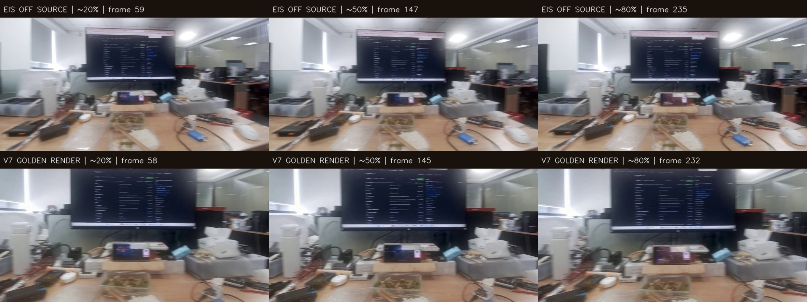
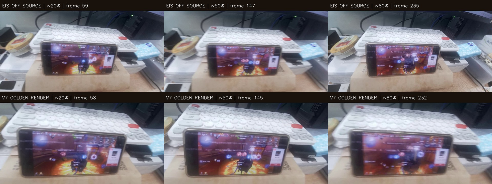

# GeminiEis — Yaw video examples for Opus 5.5

Two selected original Y1 videos and V7 golden stabilization references. **The originals have EIS OFF** and remain byte-identical copies of the 2560×1440 recording. The V7 golden reference videos are 1920×1080 H.264 CRF21 re-encodes for easier sharing.

| Test | Original video | V7 golden stabilization | Gyro / metadata |
|:--|:--|:--|:--|
| **024618 — 中抖**, bilateral medium yaw | [Source EIS-OFF MP4](024618_medium_yaw/024618_source_no_eis_2560x1440.mp4) | [Golden V7 MP4](024618_medium_yaw/024618_golden_v7_1920x1080_h264.mp4) | [Gyro](024618_medium_yaw/024618_imu.csv) · [Camera2](024618_medium_yaw/024618_camera_metadata.csv) · [PTS](024618_medium_yaw/024618_video_pts.csv) |
| **024647 — 最后一个单边抖动**, one-sided yaw / return | [Source EIS-OFF MP4](024647_one_sided_yaw/024647_source_no_eis_2560x1440.mp4) | [Golden V7 MP4](024647_one_sided_yaw/024647_golden_v7_1920x1080_h264.mp4) | [Gyro](024647_one_sided_yaw/024647_imu.csv) · [Camera2](024647_one_sided_yaw/024647_camera_metadata.csv) · [PTS](024647_one_sided_yaw/024647_video_pts.csv) |

### Medium yaw — 024618 image samples

[Video SHA256 and frame metadata](024618_medium_yaw/024618_manifest.json)

### One-sided yaw — 024647 image samples

[Video SHA256 and frame metadata](024647_one_sided_yaw/024647_manifest.json)

## Raw URLs to bypass blocked GitHub source tree browsing

- Medium original: https://raw.githubusercontent.com/poorld/GeminiEis/main/datasets/yaw_examples/024618_medium_yaw/024618_source_no_eis_2560x1440.mp4
- Medium golden: https://raw.githubusercontent.com/poorld/GeminiEis/main/datasets/yaw_examples/024618_medium_yaw/024618_golden_v7_1920x1080_h264.mp4
- One-sided original: https://raw.githubusercontent.com/poorld/GeminiEis/main/datasets/yaw_examples/024647_one_sided_yaw/024647_source_no_eis_2560x1440.mp4
- One-sided golden: https://raw.githubusercontent.com/poorld/GeminiEis/main/datasets/yaw_examples/024647_one_sided_yaw/024647_golden_v7_1920x1080_h264.mp4

Some web-fetch-based agents cannot decode or watch MP4. If Opus cannot view the videos from GitHub, **download and attach the MP4 in the Opus conversation**. The JPEG contact sheets and Markdown research reports can be read without video playback.

## Technical facts and caveats

- Source file: Y1 IMX476, 2560×1440 H.264, **295 frames** per recording, originally EIS OFF, original bytes unchanged. V7 golden: 1920×1080 H.264, **291 frames** per recording, previous offline golden render from the same original source.
- **Do not assume the same index in the two MP4s is the same sensor frame.** The contact sheet is approximate. Match `video_pts.csv` to frame/sensor timestamps with the actual replay model before pixel-exact comparison.
- EIS source Camera2 exposure ~29.996ms and rolling-shutter skew ~29.19238ms; gyro ~400Hz. Recorded Camera2 metadata has full active array crop, **not a verified post-ISP RRZO ROI**.
- Golden stabilized video is a previous **offline reference rendering**, not a new Android on-device video or a guarantee of GPU parity. Do not calibrate real camera intrinsics using re-encoded golden output; use the original EIS-OFF source video and gyro.
- The source-image reprojection model can improve while the peripheral edge-minus-center strain gets worse. The main question is **why the golden center locks extremely well while the edges stretch/compress during yaw**. Avoid claiming success solely from lower regional optical flow.

## P0–P3 research context

- [P0–P2 controller, boundary, and UV visual residual experiments](P0_P2_RESULTS_20261102.md)
- [P3 image projection, RS timing, and held-out validation](P3_CAMERA_GEOMETRY_REPORT_20261102.md)
- [Golden source with line-numbered critical code excerpts](../../OPUS_SOURCE_REVIEW.md)

**Opus 5.5 task:** Review both motion types and propose a **causal, real-time, ONE-WARP** redesign or a rigorously derived correction of calibrated SO(3) ray-space visual residuals. Center stability must not regress. Separate legitimate perspective, RS timing, camera calibration mismatch, scene parallax, and artificial per-vertex mesh deformation.
